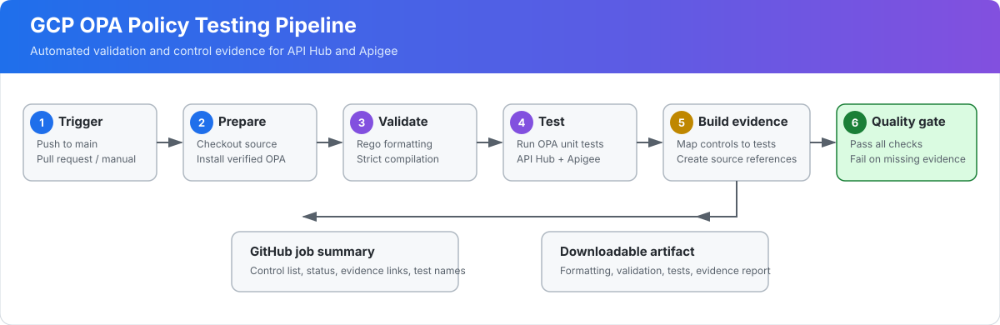

# GCP Infrastructure and OPA Policies

Terraform configurations and Open Policy Agent controls for Google Cloud services.

## Pipeline workflow

The pipeline automatically validates and tests every service policy, builds commit-pinned control evidence, publishes a GitHub job summary, and retains the complete results as a downloadable artifact. Select the diagram to open the workflow runs.

## Policy coverage

The automated workflow validates Rego formatting, performs strict policy checks, runs all unit tests, and publishes control-by-control evidence for GCP API Hub and Apigee.

The section below is generated from the latest successful `main` workflow run. It is updated only after formatting, strict validation, all unit tests, and all denial-evidence checks pass.

<!-- OPA_RESULTS_START -->

## Latest OPA control results
**Workflow run:** [View complete OPA logs and downloadable evidence](https://github.com/tevfair/GCP/actions/runs/39999350907)

> **How to read these results:** Each row is a policy unit test. The test deliberately supplies a noncompliant Terraform-plan fixture, and `Observed OPA denial` is the actual rejection returned by OPA. `Passed` means OPA produced that expected denial and the assertion succeeded. This does not claim that a live, authenticated Terraform plan was evaluated.

**Overall coverage:** 23/23 cataloged controls passed with policy and test evidence.

### API Hub

**Coverage:** 10/10 controls passed with referenced evidence.

| Control | Requirement | Result | Observed OPA denial | Source evidence | Test executed |
|---|---|---|---|---|---|
| `APIHUB-001` | Exactly one API Hub host registration and instance must exist. | **Passed** | `n/a` The plan must contain exactly one API Hub host project registration. | [policy L27](https://github.com/tevfair/GCP/blob/9e80c9b217e786157e9e09eb7eba9883c65b2728/Terraform/OPA%20Policies/API%20Hub/apihub_security.rego#L27), [test L65](https://github.com/tevfair/GCP/blob/9e80c9b217e786157e9e09eb7eba9883c65b2728/Terraform/OPA%20Policies/API%20Hub/apihub_security_test.rego#L65) | **Bad fixture:** Uses an empty Terraform plan with no host registration or API Hub instance; expects APIHUB-001 denial. **OPA test:** `test_complete_deployment_is_required` ([fixture code](https://github.com/tevfair/GCP/blob/9e80c9b217e786157e9e09eb7eba9883c65b2728/Terraform/OPA%20Policies/API%20Hub/apihub_security_test.rego#L65)) **Production configuration:** [related Terraform L7](https://github.com/tevfair/GCP/blob/9e80c9b217e786157e9e09eb7eba9883c65b2728/Terraform/API%20HUB/main.tf#L7) |
| `APIHUB-002` | The API Hub API must be enabled and retained during destroy. | **Passed** | `n/a` apihub.googleapis.com must be enabled and retained during destroy. | [policy L43](https://github.com/tevfair/GCP/blob/9e80c9b217e786157e9e09eb7eba9883c65b2728/Terraform/OPA%20Policies/API%20Hub/apihub_security.rego#L43), [test L70](https://github.com/tevfair/GCP/blob/9e80c9b217e786157e9e09eb7eba9883c65b2728/Terraform/OPA%20Policies/API%20Hub/apihub_security_test.rego#L70) | **Bad fixture:** Sets google_project_service.apihub.disable_on_destroy to true; expects APIHUB-002 denial. **OPA test:** `test_api_must_remain_enabled` ([fixture code](https://github.com/tevfair/GCP/blob/9e80c9b217e786157e9e09eb7eba9883c65b2728/Terraform/OPA%20Policies/API%20Hub/apihub_security_test.rego#L70)) **Production configuration:** [related Terraform L1](https://github.com/tevfair/GCP/blob/9e80c9b217e786157e9e09eb7eba9883c65b2728/Terraform/API%20HUB/main.tf#L1) |
| `APIHUB-003` | The host registration must use a full Google Cloud project resource name. | **Passed** | `google_apihub_host_project_registration.this` The host registration must use a full projects/PROJECT_ID resource name. | [policy L51](https://github.com/tevfair/GCP/blob/9e80c9b217e786157e9e09eb7eba9883c65b2728/Terraform/OPA%20Policies/API%20Hub/apihub_security.rego#L51), [test L80](https://github.com/tevfair/GCP/blob/9e80c9b217e786157e9e09eb7eba9883c65b2728/Terraform/OPA%20Policies/API%20Hub/apihub_security_test.rego#L80) | **Bad fixture:** Sets gcp_project to example-project instead of projects/example-project; expects APIHUB-003 denial. **OPA test:** `test_host_project_resource_name_is_required` ([fixture code](https://github.com/tevfair/GCP/blob/9e80c9b217e786157e9e09eb7eba9883c65b2728/Terraform/OPA%20Policies/API%20Hub/apihub_security_test.rego#L80)) **Production configuration:** [related Terraform L11](https://github.com/tevfair/GCP/blob/9e80c9b217e786157e9e09eb7eba9883c65b2728/Terraform/API%20HUB/main.tf#L11) |
| `APIHUB-004` | The host registration and API Hub instance must use the same explicit project. | **Passed** | `google_apihub_api_hub_instance.this` The host registration and API Hub instance must use the same project. | [policy L59](https://github.com/tevfair/GCP/blob/9e80c9b217e786157e9e09eb7eba9883c65b2728/Terraform/OPA%20Policies/API%20Hub/apihub_security.rego#L59), [test L90](https://github.com/tevfair/GCP/blob/9e80c9b217e786157e9e09eb7eba9883c65b2728/Terraform/OPA%20Policies/API%20Hub/apihub_security_test.rego#L90) | **Bad fixture:** Sets the API Hub instance project to different-project while the host uses example-project; expects APIHUB-004 denial. **OPA test:** `test_projects_must_match` ([fixture code](https://github.com/tevfair/GCP/blob/9e80c9b217e786157e9e09eb7eba9883c65b2728/Terraform/OPA%20Policies/API%20Hub/apihub_security_test.rego#L90)) **Production configuration:** [related Terraform L35](https://github.com/tevfair/GCP/blob/9e80c9b217e786157e9e09eb7eba9883c65b2728/Terraform/API%20HUB/main.tf#L35) |
| `APIHUB-005` | The host registration and API Hub instance must use the same explicit location. | **Passed** | `google_apihub_api_hub_instance.this` The host registration and API Hub instance must use the same location. | [policy L74](https://github.com/tevfair/GCP/blob/9e80c9b217e786157e9e09eb7eba9883c65b2728/Terraform/OPA%20Policies/API%20Hub/apihub_security.rego#L74), [test L101](https://github.com/tevfair/GCP/blob/9e80c9b217e786157e9e09eb7eba9883c65b2728/Terraform/OPA%20Policies/API%20Hub/apihub_security_test.rego#L101) | **Bad fixture:** Sets the instance location to europe-west1 while the host uses us-central1; expects APIHUB-005 denial. **OPA test:** `test_locations_must_match` ([fixture code](https://github.com/tevfair/GCP/blob/9e80c9b217e786157e9e09eb7eba9883c65b2728/Terraform/OPA%20Policies/API%20Hub/apihub_security_test.rego#L101)) **Production configuration:** [related Terraform L37](https://github.com/tevfair/GCP/blob/9e80c9b217e786157e9e09eb7eba9883c65b2728/Terraform/API%20HUB/main.tf#L37) |
| `APIHUB-006` | The deployment must create exactly one API Hub service identity. | **Passed** | `n/a` The plan must create exactly one API Hub service identity. | [policy L91](https://github.com/tevfair/GCP/blob/9e80c9b217e786157e9e09eb7eba9883c65b2728/Terraform/OPA%20Policies/API%20Hub/apihub_security.rego#L91), [test L112](https://github.com/tevfair/GCP/blob/9e80c9b217e786157e9e09eb7eba9883c65b2728/Terraform/OPA%20Policies/API%20Hub/apihub_security_test.rego#L112) | **Bad fixture:** Removes google_project_service_identity.apihub from the plan; expects APIHUB-006 denial. **OPA test:** `test_service_identity_is_required` ([fixture code](https://github.com/tevfair/GCP/blob/9e80c9b217e786157e9e09eb7eba9883c65b2728/Terraform/OPA%20Policies/API%20Hub/apihub_security_test.rego#L112)) **Production configuration:** [related Terraform L16](https://github.com/tevfair/GCP/blob/9e80c9b217e786157e9e09eb7eba9883c65b2728/Terraform/API%20HUB/main.tf#L16) |
| `APIHUB-007` | The API Hub service identity must receive the admin and runtime project service-agent roles. | **Passed** | `n/a` Required API Hub service identity roles are missing: {"roles/apihub.runtimeProjectServiceAgent"} | [policy L103](https://github.com/tevfair/GCP/blob/9e80c9b217e786157e9e09eb7eba9883c65b2728/Terraform/OPA%20Policies/API%20Hub/apihub_security.rego#L103), [test L121](https://github.com/tevfair/GCP/blob/9e80c9b217e786157e9e09eb7eba9883c65b2728/Terraform/OPA%20Policies/API%20Hub/apihub_security_test.rego#L121) | **Bad fixture:** Removes roles/apihub.runtimeProjectServiceAgent from the plan; expects APIHUB-007 denial. **OPA test:** `test_required_roles_are_enforced` ([fixture code](https://github.com/tevfair/GCP/blob/9e80c9b217e786157e9e09eb7eba9883c65b2728/Terraform/OPA%20Policies/API%20Hub/apihub_security_test.rego#L121)) **Production configuration:** [related Terraform L26](https://github.com/tevfair/GCP/blob/9e80c9b217e786157e9e09eb7eba9883c65b2728/Terraform/API%20HUB/main.tf#L26) |
| `APIHUB-008` | Encryption must use explicit Google-managed encryption or a valid CMEK CryptoKey resource. | **Passed** | `google_apihub_api_hub_instance.this` Encryption must use explicit GMEK or a valid CMEK CryptoKey resource name. | [policy L111](https://github.com/tevfair/GCP/blob/9e80c9b217e786157e9e09eb7eba9883c65b2728/Terraform/OPA%20Policies/API%20Hub/apihub_security.rego#L111), [test L130](https://github.com/tevfair/GCP/blob/9e80c9b217e786157e9e09eb7eba9883c65b2728/Terraform/OPA%20Policies/API%20Hub/apihub_security_test.rego#L130) | **Bad fixture:** Sets encryption_type to CMEK with cmek_key_name=invalid-key; expects APIHUB-008 denial. **OPA test:** `test_invalid_cmek_is_rejected` ([fixture code](https://github.com/tevfair/GCP/blob/9e80c9b217e786157e9e09eb7eba9883c65b2728/Terraform/OPA%20Policies/API%20Hub/apihub_security_test.rego#L130)) **Production configuration:** [related Terraform L42](https://github.com/tevfair/GCP/blob/9e80c9b217e786157e9e09eb7eba9883c65b2728/Terraform/API%20HUB/main.tf#L42) |
| `APIHUB-009` | Enabled semantic search must specify a Vertex AI location. | **Passed** | `google_apihub_api_hub_instance.this` Enabled semantic search requires an explicit Vertex AI location. | [policy L121](https://github.com/tevfair/GCP/blob/9e80c9b217e786157e9e09eb7eba9883c65b2728/Terraform/OPA%20Policies/API%20Hub/apihub_security.rego#L121), [test L145](https://github.com/tevfair/GCP/blob/9e80c9b217e786157e9e09eb7eba9883c65b2728/Terraform/OPA%20Policies/API%20Hub/apihub_security_test.rego#L145) | **Bad fixture:** Enables semantic search with disable_search=false and vertex_location=null; expects APIHUB-009 denial. **OPA test:** `test_semantic_search_requires_vertex_location` ([fixture code](https://github.com/tevfair/GCP/blob/9e80c9b217e786157e9e09eb7eba9883c65b2728/Terraform/OPA%20Policies/API%20Hub/apihub_security_test.rego#L145)) **Production configuration:** [related Terraform L43](https://github.com/tevfair/GCP/blob/9e80c9b217e786157e9e09eb7eba9883c65b2728/Terraform/API%20HUB/main.tf#L43) |
| `APIHUB-010` | The API Hub instance ID must use a stable lowercase resource-safe format. | **Passed** | `google_apihub_api_hub_instance.this` The API Hub instance ID must use lowercase letters, numbers, and hyphens. | [policy L129](https://github.com/tevfair/GCP/blob/9e80c9b217e786157e9e09eb7eba9883c65b2728/Terraform/OPA%20Policies/API%20Hub/apihub_security.rego#L129), [test L160](https://github.com/tevfair/GCP/blob/9e80c9b217e786157e9e09eb7eba9883c65b2728/Terraform/OPA%20Policies/API%20Hub/apihub_security_test.rego#L160) | **Bad fixture:** Sets api_hub_instance_id to INVALID_ID; expects APIHUB-010 denial. **OPA test:** `test_instance_id_format_is_enforced` ([fixture code](https://github.com/tevfair/GCP/blob/9e80c9b217e786157e9e09eb7eba9883c65b2728/Terraform/OPA%20Policies/API%20Hub/apihub_security_test.rego#L160)) **Production configuration:** [related Terraform L38](https://github.com/tevfair/GCP/blob/9e80c9b217e786157e9e09eb7eba9883c65b2728/Terraform/API%20HUB/main.tf#L38) |

### Apigee

**Coverage:** 13/13 controls passed with referenced evidence.

| Control | Requirement | Result | Observed OPA denial | Source evidence | Test executed |
|---|---|---|---|---|---|
| `APIGEE-001` | Exactly one organization, instance, environment, and attachment must exist. | **Passed** | `n/a` The plan must contain exactly one Apigee environment attachment. | [policy L34](https://github.com/tevfair/GCP/blob/9e80c9b217e786157e9e09eb7eba9883c65b2728/Terraform/OPA%20Policies/Apigee/apigee_security.rego#L34), [test L59](https://github.com/tevfair/GCP/blob/9e80c9b217e786157e9e09eb7eba9883c65b2728/Terraform/OPA%20Policies/Apigee/apigee_security_test.rego#L59) | **Bad fixture:** Uses an empty Terraform plan with no organization, instance, environment, or attachment; expects APIGEE-001 denial. **OPA test:** `test_empty_plan_is_rejected` ([fixture code](https://github.com/tevfair/GCP/blob/9e80c9b217e786157e9e09eb7eba9883c65b2728/Terraform/OPA%20Policies/Apigee/apigee_security_test.rego#L59)) **Production configuration:** [related Terraform L21](https://github.com/tevfair/GCP/blob/9e80c9b217e786157e9e09eb7eba9883c65b2728/Terraform/Apigee/main.tf#L21) |
| `APIGEE-002` | Required Google APIs must be present and retained during destroy. | **Passed** | `n/a` Required APIs are absent or configured to be disabled on destroy: {"servicenetworking.googleapis.com"} | [policy L65](https://github.com/tevfair/GCP/blob/9e80c9b217e786157e9e09eb7eba9883c65b2728/Terraform/OPA%20Policies/Apigee/apigee_security.rego#L65), [test L64](https://github.com/tevfair/GCP/blob/9e80c9b217e786157e9e09eb7eba9883c65b2728/Terraform/OPA%20Policies/Apigee/apigee_security_test.rego#L64) | **Bad fixture:** Removes servicenetworking.googleapis.com from the plan; expects APIGEE-002 denial. **OPA test:** `test_required_api_must_remain_enabled` ([fixture code](https://github.com/tevfair/GCP/blob/9e80c9b217e786157e9e09eb7eba9883c65b2728/Terraform/OPA%20Policies/Apigee/apigee_security_test.rego#L64)) **Production configuration:** [related Terraform L4](https://github.com/tevfair/GCP/blob/9e80c9b217e786157e9e09eb7eba9883c65b2728/Terraform/Apigee/main.tf#L4) |
| `APIGEE-003` | The Apigee organization must use the cloud runtime. | **Passed** | `google_apigee_organization.this` Apigee runtime_type must be CLOUD. | [policy L72](https://github.com/tevfair/GCP/blob/9e80c9b217e786157e9e09eb7eba9883c65b2728/Terraform/OPA%20Policies/Apigee/apigee_security.rego#L72), [test L73](https://github.com/tevfair/GCP/blob/9e80c9b217e786157e9e09eb7eba9883c65b2728/Terraform/OPA%20Policies/Apigee/apigee_security_test.rego#L73) | **Bad fixture:** Sets google_apigee_organization.runtime_type to HYBRID; expects APIGEE-003 denial. **OPA test:** `test_runtime_must_be_cloud` ([fixture code](https://github.com/tevfair/GCP/blob/9e80c9b217e786157e9e09eb7eba9883c65b2728/Terraform/OPA%20Policies/Apigee/apigee_security_test.rego#L73)) **Production configuration:** [related Terraform L29](https://github.com/tevfair/GCP/blob/9e80c9b217e786157e9e09eb7eba9883c65b2728/Terraform/Apigee/main.tf#L29) |
| `APIGEE-004` | The Apigee organization must use an explicit authorized VPC. | **Passed** | `google_apigee_organization.this` Apigee must use an explicit authorized VPC network. | [policy L79](https://github.com/tevfair/GCP/blob/9e80c9b217e786157e9e09eb7eba9883c65b2728/Terraform/OPA%20Policies/Apigee/apigee_security.rego#L79), [test L83](https://github.com/tevfair/GCP/blob/9e80c9b217e786157e9e09eb7eba9883c65b2728/Terraform/OPA%20Policies/Apigee/apigee_security_test.rego#L83) | **Bad fixture:** Sets google_apigee_organization.authorized_network to an empty string; expects APIGEE-004 denial. **OPA test:** `test_authorized_network_is_required` ([fixture code](https://github.com/tevfair/GCP/blob/9e80c9b217e786157e9e09eb7eba9883c65b2728/Terraform/OPA%20Policies/Apigee/apigee_security_test.rego#L83)) **Production configuration:** [related Terraform L28](https://github.com/tevfair/GCP/blob/9e80c9b217e786157e9e09eb7eba9883c65b2728/Terraform/Apigee/main.tf#L28) |
| `APIGEE-005` | Configured CMEK values must be full Cloud KMS CryptoKey resource names. | **Passed** | `google_apigee_organization.this` runtime_database_encryption_key_name must be a full Cloud KMS CryptoKey resource name. | [policy L93](https://github.com/tevfair/GCP/blob/9e80c9b217e786157e9e09eb7eba9883c65b2728/Terraform/OPA%20Policies/Apigee/apigee_security.rego#L93), [test L93](https://github.com/tevfair/GCP/blob/9e80c9b217e786157e9e09eb7eba9883c65b2728/Terraform/OPA%20Policies/Apigee/apigee_security_test.rego#L93) | **Bad fixture:** Sets runtime_database_encryption_key_name to not-a-kms-key; expects APIGEE-005 denial. **OPA test:** `test_invalid_kms_key_is_rejected` ([fixture code](https://github.com/tevfair/GCP/blob/9e80c9b217e786157e9e09eb7eba9883c65b2728/Terraform/OPA%20Policies/Apigee/apigee_security_test.rego#L93)) **Production configuration:** [related Terraform L33](https://github.com/tevfair/GCP/blob/9e80c9b217e786157e9e09eb7eba9883c65b2728/Terraform/Apigee/main.tf#L33) |
| `APIGEE-006` | Runtime networking must use private RFC1918 /22 address space. | **Passed** | `google_apigee_instance.this` The Apigee instance must use an RFC1918 /22 range. | [policy L109](https://github.com/tevfair/GCP/blob/9e80c9b217e786157e9e09eb7eba9883c65b2728/Terraform/OPA%20Policies/Apigee/apigee_security.rego#L109), [test L104](https://github.com/tevfair/GCP/blob/9e80c9b217e786157e9e09eb7eba9883c65b2728/Terraform/OPA%20Policies/Apigee/apigee_security_test.rego#L104) | **Bad fixture:** Sets google_apigee_instance.ip_range to public range 8.8.8.0/22; expects APIGEE-006 denial. **OPA test:** `test_public_instance_range_is_rejected` ([fixture code](https://github.com/tevfair/GCP/blob/9e80c9b217e786157e9e09eb7eba9883c65b2728/Terraform/OPA%20Policies/Apigee/apigee_security_test.rego#L104)) **Production configuration:** [related Terraform L55](https://github.com/tevfair/GCP/blob/9e80c9b217e786157e9e09eb7eba9883c65b2728/Terraform/Apigee/main.tf#L55) |
| `APIGEE-007` | The Private Service Connect consumer allowlist must not be empty. | **Passed** | `google_apigee_instance.this` The PSC consumer accept list must not be empty. | [policy L116](https://github.com/tevfair/GCP/blob/9e80c9b217e786157e9e09eb7eba9883c65b2728/Terraform/OPA%20Policies/Apigee/apigee_security.rego#L116), [test L115](https://github.com/tevfair/GCP/blob/9e80c9b217e786157e9e09eb7eba9883c65b2728/Terraform/OPA%20Policies/Apigee/apigee_security_test.rego#L115) | **Bad fixture:** Sets google_apigee_instance.consumer_accept_list to an empty list; expects APIGEE-007 denial. **OPA test:** `test_empty_psc_allowlist_is_rejected` ([fixture code](https://github.com/tevfair/GCP/blob/9e80c9b217e786157e9e09eb7eba9883c65b2728/Terraform/OPA%20Policies/Apigee/apigee_security_test.rego#L115)) **Production configuration:** [related Terraform L62](https://github.com/tevfair/GCP/blob/9e80c9b217e786157e9e09eb7eba9883c65b2728/Terraform/Apigee/main.tf#L62) |
| `APIGEE-008` | Runtime access logging must be enabled. | **Passed** | `google_apigee_instance.this` Apigee runtime access logging must be enabled. | [policy L124](https://github.com/tevfair/GCP/blob/9e80c9b217e786157e9e09eb7eba9883c65b2728/Terraform/OPA%20Policies/Apigee/apigee_security.rego#L124), [test L126](https://github.com/tevfair/GCP/blob/9e80c9b217e786157e9e09eb7eba9883c65b2728/Terraform/OPA%20Policies/Apigee/apigee_security_test.rego#L126) | **Bad fixture:** Sets access_logging_config.enabled to false; expects APIGEE-008 denial. **OPA test:** `test_disabled_access_logging_is_rejected` ([fixture code](https://github.com/tevfair/GCP/blob/9e80c9b217e786157e9e09eb7eba9883c65b2728/Terraform/OPA%20Policies/Apigee/apigee_security_test.rego#L126)) **Production configuration:** [related Terraform L66](https://github.com/tevfair/GCP/blob/9e80c9b217e786157e9e09eb7eba9883c65b2728/Terraform/Apigee/main.tf#L66) |
| `APIGEE-009` | The Apigee environment tier must be explicit and supported. | **Passed** | `google_apigee_environment.this` The Apigee environment type must be explicit. | [policy L131](https://github.com/tevfair/GCP/blob/9e80c9b217e786157e9e09eb7eba9883c65b2728/Terraform/OPA%20Policies/Apigee/apigee_security.rego#L131), [test L137](https://github.com/tevfair/GCP/blob/9e80c9b217e786157e9e09eb7eba9883c65b2728/Terraform/OPA%20Policies/Apigee/apigee_security_test.rego#L137) | **Bad fixture:** Sets environment type to ENVIRONMENT_TYPE_UNSPECIFIED; expects APIGEE-009 denial. **OPA test:** `test_environment_type_must_be_explicit` ([fixture code](https://github.com/tevfair/GCP/blob/9e80c9b217e786157e9e09eb7eba9883c65b2728/Terraform/OPA%20Policies/Apigee/apigee_security_test.rego#L137)) **Production configuration:** [related Terraform L82](https://github.com/tevfair/GCP/blob/9e80c9b217e786157e9e09eb7eba9883c65b2728/Terraform/Apigee/main.tf#L82) |
| `APIGEE-010` | The API proxy type must be explicit and supported. | **Passed** | `google_apigee_environment.this` The API proxy type must be explicit and supported. | [policy L137](https://github.com/tevfair/GCP/blob/9e80c9b217e786157e9e09eb7eba9883c65b2728/Terraform/OPA%20Policies/Apigee/apigee_security.rego#L137), [test L150](https://github.com/tevfair/GCP/blob/9e80c9b217e786157e9e09eb7eba9883c65b2728/Terraform/OPA%20Policies/Apigee/apigee_security_test.rego#L150) | **Bad fixture:** Sets api_proxy_type to API_PROXY_TYPE_UNSPECIFIED; expects APIGEE-010 denial. **OPA test:** `test_proxy_type_must_be_explicit` ([fixture code](https://github.com/tevfair/GCP/blob/9e80c9b217e786157e9e09eb7eba9883c65b2728/Terraform/OPA%20Policies/Apigee/apigee_security_test.rego#L150)) **Production configuration:** [related Terraform L83](https://github.com/tevfair/GCP/blob/9e80c9b217e786157e9e09eb7eba9883c65b2728/Terraform/Apigee/main.tf#L83) |
| `APIGEE-011` | The deployment type must be explicit and supported. | **Passed** | `google_apigee_environment.this` The deployment type must be explicit and supported. | [policy L143](https://github.com/tevfair/GCP/blob/9e80c9b217e786157e9e09eb7eba9883c65b2728/Terraform/OPA%20Policies/Apigee/apigee_security.rego#L143), [test L163](https://github.com/tevfair/GCP/blob/9e80c9b217e786157e9e09eb7eba9883c65b2728/Terraform/OPA%20Policies/Apigee/apigee_security_test.rego#L163) | **Bad fixture:** Sets deployment_type to DEPLOYMENT_TYPE_UNSPECIFIED; expects APIGEE-011 denial. **OPA test:** `test_deployment_type_must_be_explicit` ([fixture code](https://github.com/tevfair/GCP/blob/9e80c9b217e786157e9e09eb7eba9883c65b2728/Terraform/OPA%20Policies/Apigee/apigee_security_test.rego#L163)) **Production configuration:** [related Terraform L87](https://github.com/tevfair/GCP/blob/9e80c9b217e786157e9e09eb7eba9883c65b2728/Terraform/Apigee/main.tf#L87) |
| `APIGEE-012` | A configured forward proxy must use HTTPS and an explicit port. | **Passed** | `google_apigee_environment.this` The forward proxy must use HTTPS with an explicit port. | [policy L152](https://github.com/tevfair/GCP/blob/9e80c9b217e786157e9e09eb7eba9883c65b2728/Terraform/OPA%20Policies/Apigee/apigee_security.rego#L152), [test L176](https://github.com/tevfair/GCP/blob/9e80c9b217e786157e9e09eb7eba9883c65b2728/Terraform/OPA%20Policies/Apigee/apigee_security_test.rego#L176) | **Bad fixture:** Sets forward_proxy_uri to insecure http://proxy.internal:8080; expects APIGEE-012 denial. **OPA test:** `test_insecure_forward_proxy_is_rejected` ([fixture code](https://github.com/tevfair/GCP/blob/9e80c9b217e786157e9e09eb7eba9883c65b2728/Terraform/OPA%20Policies/Apigee/apigee_security_test.rego#L176)) **Production configuration:** [related Terraform L91](https://github.com/tevfair/GCP/blob/9e80c9b217e786157e9e09eb7eba9883c65b2728/Terraform/Apigee/main.tf#L91) |
| `APIGEE-013` | Client-IP resolution must use a trusted, nonzero X-Forwarded-For index. | **Passed** | `google_apigee_environment.this` Client IP resolution must use a documented non-zero trusted proxy index. | [policy L164](https://github.com/tevfair/GCP/blob/9e80c9b217e786157e9e09eb7eba9883c65b2728/Terraform/OPA%20Policies/Apigee/apigee_security.rego#L164), [test L189](https://github.com/tevfair/GCP/blob/9e80c9b217e786157e9e09eb7eba9883c65b2728/Terraform/OPA%20Policies/Apigee/apigee_security_test.rego#L189) | **Bad fixture:** Sets X-Forwarded-For ip_header_index to untrusted value 0; expects APIGEE-013 denial. **OPA test:** `test_untrusted_client_ip_index_is_rejected` ([fixture code](https://github.com/tevfair/GCP/blob/9e80c9b217e786157e9e09eb7eba9883c65b2728/Terraform/OPA%20Policies/Apigee/apigee_security_test.rego#L189)) **Production configuration:** [related Terraform L95](https://github.com/tevfair/GCP/blob/9e80c9b217e786157e9e09eb7eba9883c65b2728/Terraform/Apigee/main.tf#L95) |

### Evidence context

- Commit tested: `9e80c9b217e786157e9e09eb7eba9883c65b2728`
- OPA version: `0.68.0`
- Evidence links are pinned to the exact commit tested by this workflow.
- `Test executed` identifies the deliberately bad Terraform-plan fixture, the Rego test function, and the related production `.tf` setting.
- Unit tests construct synthetic Terraform plan JSON; they do not execute the production `.tf` file. The production link shows the setting that the fixture models.
- `Passed` means the negative fixture produced the displayed denial and the OPA assertion passed.
- The displayed denials are parsed directly from OPA's `EXPECTED_DENIAL` test logs, not inferred by the report generator.
- The valid fixture separately logs `VALID_PLAN ... denials=0`.

<!-- OPA_RESULTS_END -->
